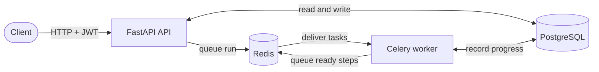

# CogniCortex

[](https://github.com/Aayushkumar-gupta/cognicortex/actions/workflows/ci.yml)


**A workflow automation engine: define a workflow as a set of steps, start a run, and background workers execute the steps in dependency order while the API reports live progress.**

## Overview

Multi-step work should not hold up an API request. CogniCortex accepts a workflow run, returns straight away, and hands the steps to background workers. The workers run each step as soon as the steps it depends on have succeeded, record its status, timing, and any error, and stop the steps downstream of a failure. The API reports the run's progress at any time.

## Highlights

- **Asynchronous by design:** starting a run returns `202 Accepted` with a run id immediately; Celery workers do the work in the background, so the API stays fast however long a workflow takes.
- **Dependency-ordered execution:** a step is dispatched only once all of its parent steps have succeeded, independent steps run in parallel, and a failed step stops everything downstream of it.
- **Per-user data isolation:** every workflow and run query is scoped to the logged-in user; another user's data returns `404`, never a hint that it exists.
- **Schema under version control:** the database is managed with Alembic migrations, and a test builds the database from the migrations and compares it with the models, so the two can never drift apart.
- **Secure by default:** Argon2 password hashing, signed JWT access tokens with a fixed algorithm, and the app refuses to start with a secret key shorter than 32 characters.
- **One-command environment:** Docker Compose starts PostgreSQL, Redis, the migrations, the API, and a worker in the right order using health checks.
- **Tested and automated:** 23 tests with 97% coverage, run by GitHub Actions on every push against a real PostgreSQL database, together with linting, formatting checks, and a Docker build. Dependabot proposes dependency updates weekly.

## Architecture



The API and the workers are separate processes that share one database, and Redis carries jobs between them. A run moves through these stages:

1. **Start:** the API checks that the workflow belongs to the caller, records a new run, queues it, and returns the run id.
2. **Dispatch:** a worker loads the run and queues every step whose parent steps have all succeeded.
3. **Execute:** each step records `RUNNING`, its start and finish times, and its result: `SUCCESS`, or `FAILED` with the error message.
4. **Advance:** after each step, the engine looks for steps that are now ready and dispatches them.
5. **Finish:** once no step is queued or running, the run is marked `FINISHED`, or `FAILED` if any step failed.

## Quick start

Requires Docker.

```bash
git clone https://github.com/Aayushkumar-gupta/cognicortex.git
cd cognicortex
cp .env.example .env
```

Set `SECRET_KEY` in `.env` to at least 32 characters, for example the output of `python3 -c "import secrets; print(secrets.token_urlsafe(48))"`. Then start everything:

```bash
docker compose up --build
```

The API is now running at http://localhost:8000, with interactive documentation at http://localhost:8000/docs. `Ctrl+C` stops the stack; `docker compose down -v` also deletes its data.

## Try it

With the stack running, create an account, log in, define a workflow, and run it:

```bash
API=http://localhost:8000/api/v1

curl -X POST $API/users -H "Content-Type: application/json" \
  -d '{"email": "ada@example.com", "username": "ada", "name": "Ada", "password": "correct-horse-battery"}'

TOKEN=$(curl -s -X POST $API/auth/login -d "username=ada@example.com&password=correct-horse-battery" \
  | python3 -c "import sys, json; print(json.load(sys.stdin)['access_token'])")

curl -X POST $API/workflows -H "Authorization: Bearer $TOKEN" -H "Content-Type: application/json" \
  -d '{"name": "Customer onboarding", "steps": [
        {"name": "Send welcome email", "step_type": "action", "config": {}},
        {"name": "Create CRM record", "step_type": "action", "config": {}}]}'

curl -X POST "$API/workflow_runs?workflow_id=1" -H "Authorization: Bearer $TOKEN"
# {"workflow_run_id": 1, "status": "RUNNING"}

curl $API/workflow_runs/1 -H "Authorization: Bearer $TOKEN"
```

The last call returns the run with a summary and every step's timing:

```json
{
  "workflow_run_id": 1,
  "workflow_name": "Customer onboarding",
  "status": "FINISHED",
  "started_at": "2026-11-04T20:39:32.981513+00:00",
  "finished_at": "2026-11-04T20:39:34.190779+00:00",
  "summary": {
    "total_tasks": 2,
    "completed_tasks": 2,
    "running_tasks": 0,
    "failed_tasks": 0,
    "pending_tasks": 0
  },
  "tasks": [
    {
      "task_name": "Create CRM record",
      "status": "SUCCESS",
      "started_at": "2026-11-04T20:39:34.178969+00:00",
      "finished_at": "2026-11-04T20:39:34.182627+00:00",
      "duration_seconds": 0.003658,
      "error_message": null
    },
    {
      "task_name": "Send welcome email",
      "status": "SUCCESS",
      "started_at": "2026-11-04T20:39:34.178865+00:00",
      "finished_at": "2026-11-04T20:39:34.183000+00:00",
      "duration_seconds": 0.004135,
      "error_message": null
    }
  ]
}
```

The two steps have no dependency on each other, so the worker ran them in parallel.

## Local development

Requires Python 3.13, PostgreSQL, and Redis.

```bash
python3.13 -m venv venv
source venv/bin/activate
pip install -r requirements-dev.txt
pre-commit install
cp .env.example .env
```

Create a database user and database, put the password and a `SECRET_KEY` in `.env`, and apply the migrations:

```bash
psql -d postgres -c "CREATE ROLE cognicortex LOGIN PASSWORD 'change-me'"
createdb -O cognicortex cognicortex
alembic upgrade head
```

Start Redis, for example with `brew services start redis` or `docker run -d -p 6379:6379 redis:8`, then run the API and a worker in two terminals:

```bash
uvicorn app.main:app --reload
celery -A app.workers.celery_app:celery_app worker --loglevel=info
```

## Configuration

Settings are read from environment variables, or from a `.env` file in the project root (see [`.env.example`](.env.example)). Unknown keys are rejected at startup, so a mistyped setting is caught immediately.

| Variable | Default | Purpose |
| --- | --- | --- |
| `DATABASE_URL` | **required** | PostgreSQL connection string |
| `SECRET_KEY` | **required**, 32+ characters | Signs the access tokens |
| `REDIS_URL` | `redis://localhost:6379/0` | Celery broker and result backend |
| `ACCESS_TOKEN_EXPIRE_MINUTES` | `30` | Lifetime of an access token |
| `APP_NAME` | `CogniCortex` | Name shown in the API docs and health check |

## API reference

All routes are under `/api/v1`. Every route except the health check, sign-up, and login requires a bearer token.

| Method | Route | Purpose |
| --- | --- | --- |
| `GET` | `/health` | Health check |
| `POST` | `/users` | Create an account |
| `POST` | `/auth/login` | Log in and receive an access token |
| `POST` | `/workflows` | Create a workflow with its steps |
| `GET` | `/workflows` | List your workflows |
| `GET` `PUT` `DELETE` | `/workflows/{id}` | Read, update, or delete a workflow |
| `POST` | `/workflow_runs?workflow_id={id}` | Start a run |
| `GET` | `/workflow_runs/{id}` | Run status, step summary, and timings |

## Testing and CI

```bash
pytest                                     # run the tests on a throwaway SQLite database
pytest --cov=app --cov-report=term-missing # with coverage
pre-commit run --all-files                 # Ruff linting and formatting, and file checks
```

To run the tests on PostgreSQL, as CI does, point `TEST_DATABASE_URL` at a separate database. The tests drop every table, so never point it at a database you want to keep:

```bash
createdb cognicortex_test
TEST_DATABASE_URL=postgresql+psycopg://localhost/cognicortex_test pytest
```

On every push and pull request, [GitHub Actions](.github/workflows/ci.yml) runs the pre-commit checks and the full test suite against a PostgreSQL 17 service, and builds the Docker image.

## Project structure

```
app/api/        HTTP routes
app/core/       Settings, password hashing, and access tokens
app/db/         Database session and models
app/engine/     Decides which steps are ready and dispatches them
app/schemas/    Request and response models
app/workers/    Celery app and the tasks that run workflows and steps
migrations/     Alembic migrations
tests/          Test suite
```

## License

Copyright © 2025-2026 Aayush Kumar Gupta. All rights reserved. The code is published for viewing only; see [LICENSE](LICENSE).
